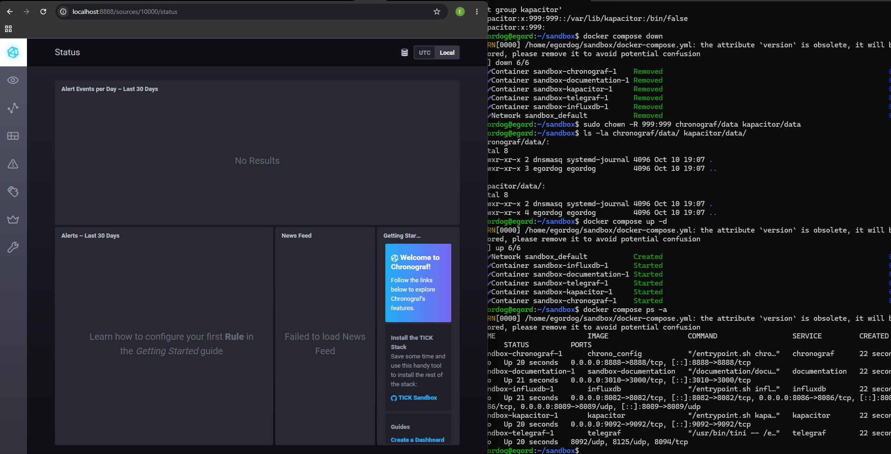
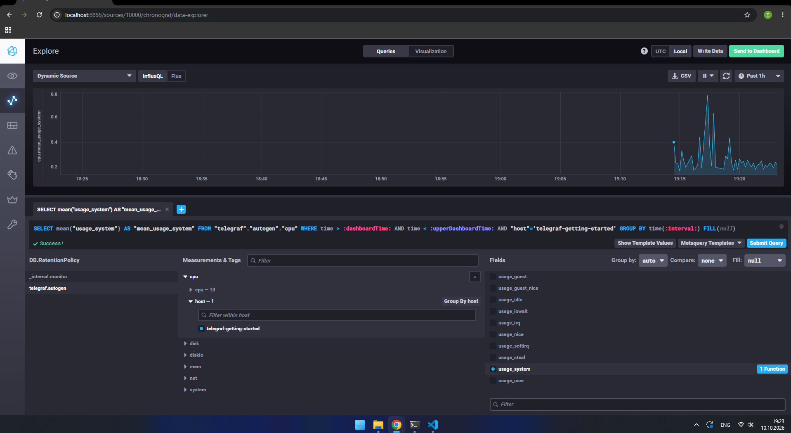
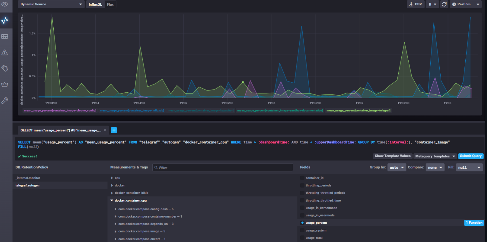

# Домашнее задание к занятию "`13.Системы мониторинга`" - `Доготер Егор`


### Задание 1

1. `Вас пригласили настроить мониторинг на проект. На онбординге вам рассказали, что проект представляет из себя платформу для вычислений с выдачей текстовых отчетов, которые сохраняются на диск. Взаимодействие с платформой осуществляется по протоколу http. Также вам отметили, что вычисления загружают ЦПУ. Какой минимальный набор метрик вы выведите в мониторинг и почему?`

#### Ответ:
Для мониторинга данной платформы необходим комбинированный подход: 
    - сбор системных метрик (инфраструктура) и прикладных (бизнес-логика).
    - CPU Usage / CPU LA: вычисления загружают процессор, нужно вовремя заметить полку утилизации.
    - Disk Free Space / Disk IO: текстовые отчеты сохраняются на диск. При нехватке места или перегрузке дисковой подсистемы платформа перестанет работать.
    - Inodes (свободные индексные дескрипторы): так как генерируется множество текстовых файлов (отчетов), inodes могут закончиться гораздо раньше, чем физическое место на диске.
    - HTTP Requests (Общее количество запросов, RPS): для понимания текущей интенсивности нагрузки по HTTP.
    - HTTP Response Codes (2xx, 4xx, 5xx): для контроля ошибок. Появление 5xx кодов скажет о внутренних сбоях, а 4xx — об ошибках клиентов или атаках.

2. `Менеджер продукта посмотрев на ваши метрики сказал, что ему непонятно что такое RAM/inodes/CPUla. Также он сказал, что хочет понимать, насколько мы выполняем свои обязанности перед клиентами и какое качество обслуживания. Что вы можете ему предложить?`

#### Ответ:
Ему нужно предложить внедрение методологии SRE (Service Level Objectives):
    - SLI (Service Level Indicator) — измеримый показатель глазами клиента. Примеры: «доля успешных HTTP-ответов (2xx) за 5 минут», «p95 времени ответа», «успешно сформированных отчётов / всего запрошенных».
    - SLO (Service Level Objective) — внутренняя цель по SLI. Например: «99.5% успешных ответов за 30 дней». SLO — компромисс между надёжностью и скоростью релизов.
    - SLA (Service Level Agreement) — внешнее соглашение с клиентом, обычно мягче SLO (например, SLA 99%, SLO 99.5%), чтобы был буфер.


3.  `Вашей DevOps команде в этом году не выделили финансирование на построение системы сбора логов. Разработчики в свою очередь хотят видеть все ошибки, которые выдают их приложения. Какое решение вы можете предпринять в этой ситуации, чтобы разработчики получали ошибки приложения?`

#### Ответ:
Если нет ресурсов на разворачивание крупных систем сбора логов, можно использовать легковесные бесплатные альтернативы:
    - Sentry/GlitchTip  — специализированные системы для трекинга ошибок и исключений.
    - Встроенные средства докера/systemd (journald) — настроить отправку логов ошибок через простые скрипты в мессенджеры (Telegram, Slack) или на почту.
    - Rsyslog на одну машину и грепать ключевые слова ERROR / CRITICAL

4.  `Вы, как опытный SRE, сделали мониторинг, куда вывели отображения выполнения SLA=99% по http кодам ответов. Вычисляете этот параметр по следующей формуле: summ_2xx_requests/summ_all_requests. Данный параметр не поднимается выше 70%, но при этом в вашей системе нет кодов ответа 5xx и 4xx. Где у вас ошибка?`

#### Ответ:
Формула summ_2xx_requests / summ_all_requests учитывает только успешные ответы 200-й серии.
Если в системе нет ошибок 4xx и 5xx, но значение равно 70%, это означает, что оставшиеся 30% запросов возвращают 3xx коды ответов (HTTP Redirects).
Правильный вариант: SLI = (sum(2xx) + sum(3xx)) / sum(all)

5.  `Опишите основные плюсы и минусы pull и push систем мониторинга.`

#### Ответ:
Pull (сервер сам забирает метрики)
#### Плюсы:
* Централизованный контроль частоты и таймаутов — предсказуемая нагрузка.
* Легче защитить сервер (не принимает входящие соединения)
* Просто узнать, если агент «умер» (отвалился таймаут)
* Удобно отлаживать: curl /metrics руками.
#### Минусы:
* Плохо для сред за NAT, где Prometheus не достучится до таргета
* Требуется доступ от сервера мониторинга к каждому таргету (firewall).
* Требуется настройка Service Discovery
Push (агенты сами шлют метрики)	
#### Плюсы:
* Удобно для изолированных сред за NAT и динамических инстансов
* Меньше нагрузка на центральный сервер
* Не нужен доступ от коллектора к агентам — только от агентов к коллектору.
Минусы:
* Сложнее контролировать поток данных от агентов
* Труднее оперативно узнать, что конкретный агент перестал работать

6.  `Какие из ниже перечисленных систем относятся к push модели, а какие к pull? А может есть гибридные?`

* Prometheus
* TICK
* Zabbix
* VictoriaMetrics
* Nagios

#### Ответ:
Prometheus: 
    Pull

TICK (Telegraf, InfluxDB, Chronograf, Kapacitor):
    Преимущественно Push (Telegraf собирает метрики и пушит их в InfluxDB).

Zabbix:
    Гибридная. Passive agent = pull, Active agent = push, Trapper = push. Выбор режима на уровне шаблона/хоста.

VictoriaMetrics:
    Гибридная. Изначально создавалась как TSDB для интеграции с Prometheus (Pull), но умеет принимать данные по протоколам InfluxDB/Graphite/OpenTSDB (Push).

Nagios:
    Pull

7.  `Склонируйте себе репозиторий и запустите TICK-стэк, используя технологии docker и docker-compose.`
В виде решения на это упражнение приведите скриншот веб-интерфейса ПО chronograf (http://localhost:8888).

#### Ответ:


8.  `Перейдите в веб-интерфейс Chronograf (http://localhost:8888) и откройте вкладку Data explorer.`

* Нажмите на кнопку Add a query
* Изучите вывод интерфейса и выберите БД telegraf.autogen
* В measurments выберите cpu->host->telegraf-getting-started, а в fields выберите usage_system. Внизу появится график утилизации cpu.
* Вверху вы можете увидеть запрос, аналогичный SQL-синтаксису. Поэкспериментируйте с запросом, попробуйте изменить группировку и интервал наблюдений.

Для выполнения задания приведите скриншот с отображением метрик утилизации cpu из веб-интерфейса.

#### Ответ:


9.  `Изучите список telegraf inputs. Добавьте в конфигурацию telegraf следующий плагин - docker:`
```
[[inputs.docker]]
  endpoint = "unix:///var/run/docker.sock"
```
Дополнительно вам может потребоваться донастройка контейнера telegraf в docker-compose.yml дополнительного volume и режима privileged:
```
  telegraf:
    image: telegraf:1.4.0
    privileged: true
    volumes:
      - ./etc/telegraf.conf:/etc/telegraf/telegraf.conf:Z
      - /var/run/docker.sock:/var/run/docker.sock:Z
    links:
      - influxdb
    ports:
      - "8092:8092/udp"
      - "8094:8094"
      - "8125:8125/udp"
```
#### Ответ:

