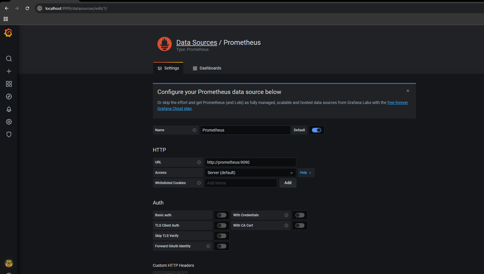
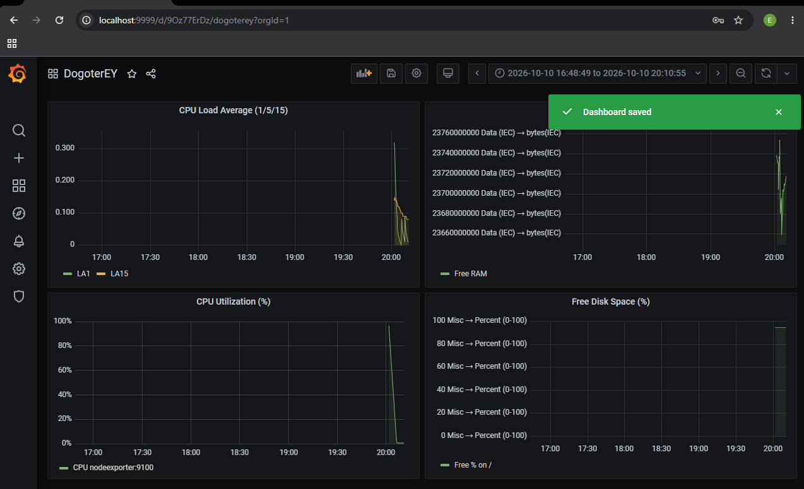

# Домашнее задание к занятию 14"`Средство визуализации Grafana`" - `Доготер Егор`

### Задание 1

1. `Используя директорию help внутри этого домашнего задания, запустите связку prometheus-grafana.`
2. `Зайдите в веб-интерфейс grafana, используя авторизационные данные, указанные в манифесте docker-compose.`
3. `Подключите поднятый вами prometheus, как источник данных.`
4. `Решение домашнего задания — скриншот веб-интерфейса grafana со списком подключенных Datasource.`

#### Ответ:

### Задание 2

1. `Создайте Dashboard и в ней создайте Panels:`

* утилизация CPU для nodeexporter (в процентах, 100-idle);
* CPULA 1/5/15;
* количество свободной оперативной памяти;
* количество места на файловой системе.

#### Ответ:
Утилизация CPU для nodeexporter - `100 - (avg by (instance) (rate(node_cpu_seconds_total{mode="idle"}[5m])) * 100)`

CPULA 1/5/15 - `node_load1 node_load5 node_load15`

Количество свободной оперативной памяти - `node_memory_MemAvailable_bytes`

Количество места на файловой системе - `100 * node_filesystem_avail_bytes{mountpoint="/",fstype!="rootfs"}`
    `/ node_filesystem_size_bytes{mountpoint="/",fstype!="rootfs"}`

### Задание 3

1.  `Создайте для каждой Dashboard подходящее правило alert — можно обратиться к первой лекции в блоке «Мониторинг».`
2.  `В качестве решения задания приведите скриншот вашей итоговой Dashboard.`

#### Ответ:

### Задание 4

1.  `Создайте для каждой Dashboard подходящее правило alert — можно обратиться к первой лекции в блоке «Мониторинг».`
2.  `В качестве решения задания приведите скриншот вашей итоговой Dashboard.`

#### Ответ:
[Dashboard](dashboard.json)

